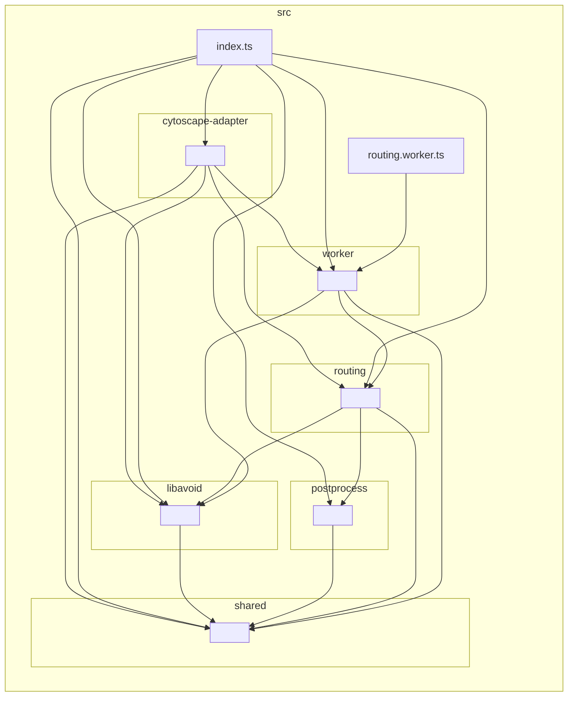
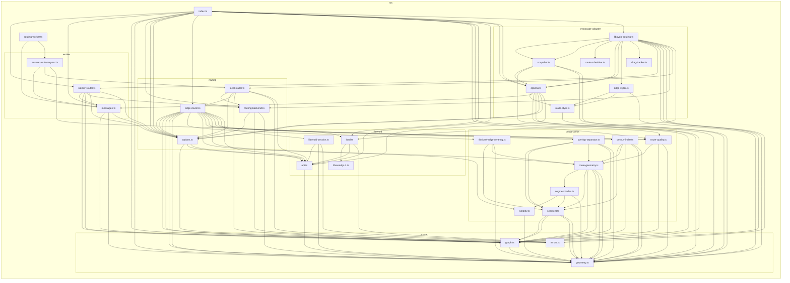

# Dependencies of src/

Generated by `npm run deps` (dependency-cruiser), do not edit. An arrow points
from the importing module to the imported one; `import type` counts as well.
`npm run deps:check` checks the layering rules in `.dependency-cruiser.cjs`.

## Folders

## Files

